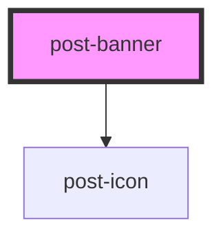

# post-alert

<!-- Auto Generated Below -->

## Properties

| Property | Attribute | Description             | Type                                                     | Default  |
| -------- | --------- | ----------------------- | -------------------------------------------------------- | -------- |
| `type`   | `type`    | The type of the banner. | `"error" \| "grief" \| "info" \| "success" \| "warning"` | `'info'` |

## Events

| Event           | Description                                                                                                                               | Type                |
| --------------- | ----------------------------------------------------------------------------------------------------------------------------------------- | ------------------- |
| `postDismissed` | An event emitted when the banner element is dismissed, after the transition. It has no payload and only relevant for dismissible banners. | `CustomEvent<void>` |

## Methods

### `dismiss() => Promise<void>`

Triggers banner dismissal programmatically (same as clicking on the close button (×)).

#### Returns

Type: `Promise<void>`

## Slots

| Slot             | Description                                                                     |
| ---------------- | ------------------------------------------------------------------------------- |
| `"actions"`      | Slot for placing custom actions (buttons, links, etc.) within the banner.       |
| `"close-button"` | Slot for placing a `post-closebutton` component to make the banner dismissible. |
| `"default"`      | Slot for placing the main content/message of the banner.                        |
| `"heading"`      | Slot for placing custom content within the banner's heading.                    |

## Dependencies

### Depends on

- [post-icon](../post-icon)

### Graph

----------------------------------------------

*Built with [StencilJS](https://stenciljs.com/)*
