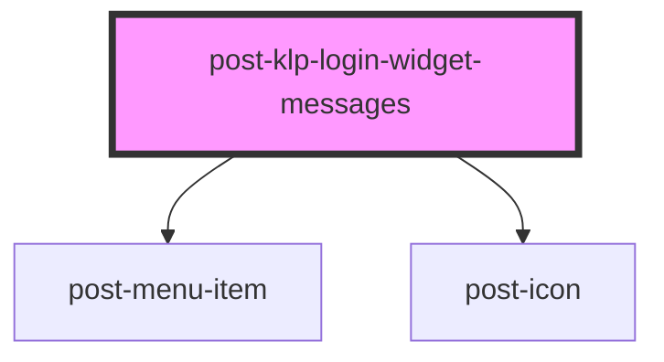

# post-klp-login-widget-messages

<!-- Auto Generated Below -->

## Properties

| Property           | Attribute     | Description                                                                                                                | Type     | Default     |
| ------------------ | ------------- | -------------------------------------------------------------------------------------------------------------------------- | -------- | ----------- |
| `text`             | `text`        | Label of the entry.                                                                                                        | `string` | `undefined` |
| `textUnread`       | `text-unread` | Visually hidden label for the unread count. The placeholder `{count}` will be replaced with the number of unread messages. | `string` | `undefined` |
| `url` _(required)_ | `url`         | Where the entry points.                                                                                                    | `string` | `undefined` |

## Dependencies

### Depends on

- [post-menu-item](../post-menu-item)
- [post-icon](../post-icon)

### Graph

----------------------------------------------

*Built with [StencilJS](https://stenciljs.com/)*
