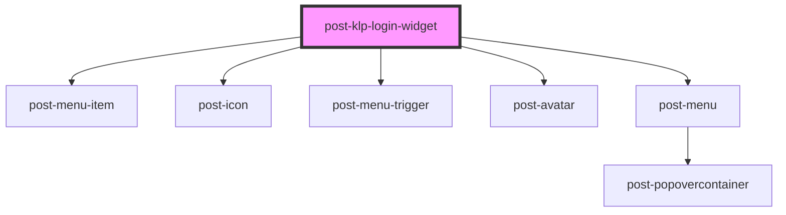

# post-klp-login-widget

<!-- Auto Generated Below -->

## Properties

| Property                       | Attribute             | Description                                                                                                                                                                                                                                                                                                              | Type                                                                      | Default                      |
| ------------------------------ | --------------------- | ------------------------------------------------------------------------------------------------------------------------------------------------------------------------------------------------------------------------------------------------------------------------------------------------------------------------ | ------------------------------------------------------------------------- | ---------------------------- |
| `app`                          | `app`                 | The KLP application sent as `app` with the login and the switches. Defaults to `service`.                                                                                                                                                                                                                                | `string`                                                                  | `undefined`                  |
| `environment`                  | `environment`         | The KLP platform instance to talk to. Determines the backend and the default link targets.                                                                                                                                                                                                                               | `"dev01" \| "dev02" \| "devs1" \| "int01" \| "int02" \| "prod" \| "test"` | `'prod'`                     |
| `inIframe`                     | `in-iframe`           | Whether the page runs inside an iframe, sent as `inIframe` with the switches and the logout.                                                                                                                                                                                                                             | `boolean`                                                                 | `false`                      |
| `initialState`                 | `initial-state`       | What to show before the session is known. Leave unset unless the server already knows who the visitor is: the widget then shows an avatar without initials, which costs anonymous visitors a short placeholder but never flashes the wrong state at anyone. Set `anonymous` to render the login link right away instead. | `"anonymous" \| "authenticated"`                                          | `undefined`                  |
| `keepAliveDisabled`            | `keep-alive-disabled` | Whether to stop refreshing the session while the user is active on the page.                                                                                                                                                                                                                                             | `boolean`                                                                 | `false`                      |
| `keepAliveEvents`              | `keep-alive-events`   | Space separated list of the events that count as user activity.                                                                                                                                                                                                                                                          | `string`                                                                  | `'click touchstart keydown'` |
| `keepAliveInterval`            | `keep-alive-interval` | Minutes between two keep-alive ticks.                                                                                                                                                                                                                                                                                    | `number`                                                                  | `9`                          |
| `keepAliveUrl`                 | `keep-alive-url`      | The portal's own keep-alive url. The platform session is refreshed either way.                                                                                                                                                                                                                                           | `string`                                                                  | `undefined`                  |
| `language`                     | `language`            | The language of the default texts and link targets: `de`, `fr`, `it` or `en`. Defaults to `<html lang>`, then to the browser's preferred language, then to `de`.                                                                                                                                                         | `string`                                                                  | `undefined`                  |
| `service` _(required)_         | `service`             | The application registered with KLP, sent as `service` with the login and the switches, so KLP returns the user to it.                                                                                                                                                                                                   | `string`                                                                  | `undefined`                  |
| `textCurrentUser` _(required)_ | `text-current-user`   | Visually hidden label for the current user. The placeholder `{user}` will be replaced with the full name of the currently logged-in user.                                                                                                                                                                                | `string`                                                                  | `undefined`                  |
| `textUserLinks` _(required)_   | `text-user-links`     | Visually hidden label for the user menu.                                                                                                                                                                                                                                                                                 | `string`                                                                  | `undefined`                  |
| `urlAccountSwitch`             | `url-account-switch`  | Overrides the target of the account switch.                                                                                                                                                                                                                                                                              | `string`                                                                  | `undefined`                  |
| `urlCompanySwitch`             | `url-company-switch`  | Overrides the target of the company switch.                                                                                                                                                                                                                                                                              | `string`                                                                  | `undefined`                  |
| `urlLogin`                     | `url-login`           | Overrides the target of the login link.                                                                                                                                                                                                                                                                                  | `string`                                                                  | `undefined`                  |
| `urlLogout`                    | `url-logout`          | Overrides the target of the logout entry.                                                                                                                                                                                                                                                                                | `string`                                                                  | `undefined`                  |
| `urlMessages`                  | `url-messages`        | Overrides the target of the messages entry.                                                                                                                                                                                                                                                                              | `string`                                                                  | `undefined`                  |
| `urlMyProfile`                 | `url-my-profile`      | Overrides the target of the profile entry.                                                                                                                                                                                                                                                                               | `string`                                                                  | `undefined`                  |
| `urlSettings`                  | `url-settings`        | Overrides the target of the settings entry.                                                                                                                                                                                                                                                                              | `string`                                                                  | `undefined`                  |

## Slots

| Slot                       | Description                                                                                                                          |
| -------------------------- | ------------------------------------------------------------------------------------------------------------------------------------ |
| `"default"`                | Custom entries, listed between settings and logout in the user menu. Each one must be a `post-menu-item` holding a link or a button. |
| `"text-access-user-links"` | Replaces the visually hidden label of the button that opens the user menu.                                                           |
| `"text-account-switch"`    | Replaces the text of the account switch.                                                                                             |
| `"text-company-switch"`    | Replaces the text of the company switch.                                                                                             |
| `"text-login"`             | Replaces the text of the login link.                                                                                                 |
| `"text-logout"`            | Replaces the text of the logout entry.                                                                                               |
| `"text-messages"`          | Replaces the text of the messages entry.                                                                                             |
| `"text-my-profile"`        | Replaces the text of the profile entry.                                                                                              |
| `"text-settings"`          | Replaces the text of the settings entry.                                                                                             |
| `"text-unread-messages"`   | Replaces the visually hidden text after the number of unread messages.                                                               |

## Dependencies

### Depends on

- [post-menu-item](../post-menu-item)
- [post-icon](../post-icon)
- [post-menu-trigger](../post-menu-trigger)
- [post-avatar](../post-avatar)
- [post-menu](../post-menu)

### Graph

----------------------------------------------

*Built with [StencilJS](https://stenciljs.com/)*
