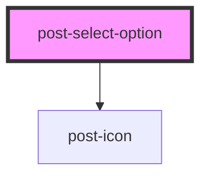

# post-select-option

<!-- Auto Generated Below -->

## Properties

| Property             | Attribute     | Description                                                        | Type      | Default     |
| -------------------- | ------------- | ------------------------------------------------------------------ | --------- | ----------- |
| `disabled`           | `disabled`    | Prevents this option from being selected.                          | `boolean` | `false`     |
| `highlighted`        | `highlighted` | Whether the option is highlighted by keyboard navigation.          | `boolean` | `false`     |
| `icon`               | `icon`        | Optional icon displayed before the option label.                   | `string`  | `undefined` |
| `selected`           | `selected`    | Whether the option is selected.                                    | `boolean` | `false`     |
| `value` _(required)_ | `value`       | Value associated with this option. Also used as its default label. | `string`  | `undefined` |

## Events

| Event                | Description                                                        | Type                  |
| -------------------- | ------------------------------------------------------------------ | --------------------- |
| `postOptionSelected` | Emitted when the option is selected. Bubbles to the parent select. | `CustomEvent<string>` |

## Slots

| Slot | Description                                                               |
| ---- | ------------------------------------------------------------------------- |
|      | Optional custom content replacing the default text and icon presentation. |

## Dependencies

### Depends on

- [post-icon](../post-icon)

### Graph

----------------------------------------------

*Built with [StencilJS](https://stenciljs.com/)*
