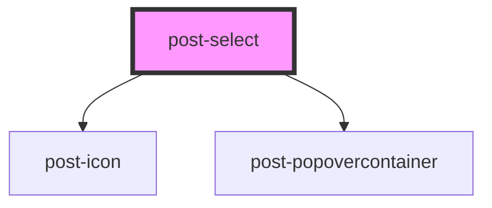

# post-select

<!-- Auto Generated Below -->

## Properties

| Property          | Attribute         | Description                                                                        | Type      | Default              |
| ----------------- | ----------------- | ---------------------------------------------------------------------------------- | --------- | -------------------- |
| `accessibleLabel` | `aria-label`      | Accessible name for the select. Prefer an associated visible label where possible. | `string`  | `undefined`          |
| `ariaLabelledby`  | `aria-labelledby` | ID of the visible label that names the select.                                     | `string`  | `undefined`          |
| `disabled`        | `disabled`        | Disables the select.                                                               | `boolean` | `false`              |
| `placeholder`     | `placeholder`     | Text displayed when no option is selected.                                         | `string`  | `'Select an option'` |
| `value`           | `value`           | The selected option value.                                                         | `string`  | `undefined`          |

## Events

| Event        | Description                              | Type                  |
| ------------ | ---------------------------------------- | --------------------- |
| `postChange` | Emitted when the selected value changes. | `CustomEvent<string>` |

## Slots

| Slot | Description                       |
| ---- | --------------------------------- |
|      | Options to display in the select. |

## Shadow Parts

| Part                    | Description |
| ----------------------- | ----------- |
| `"post-select-trigger"` |             |

## Dependencies

### Depends on

- [post-icon](../post-icon)
- [post-popovercontainer](../post-popovercontainer)

### Graph

----------------------------------------------

*Built with [StencilJS](https://stenciljs.com/)*
